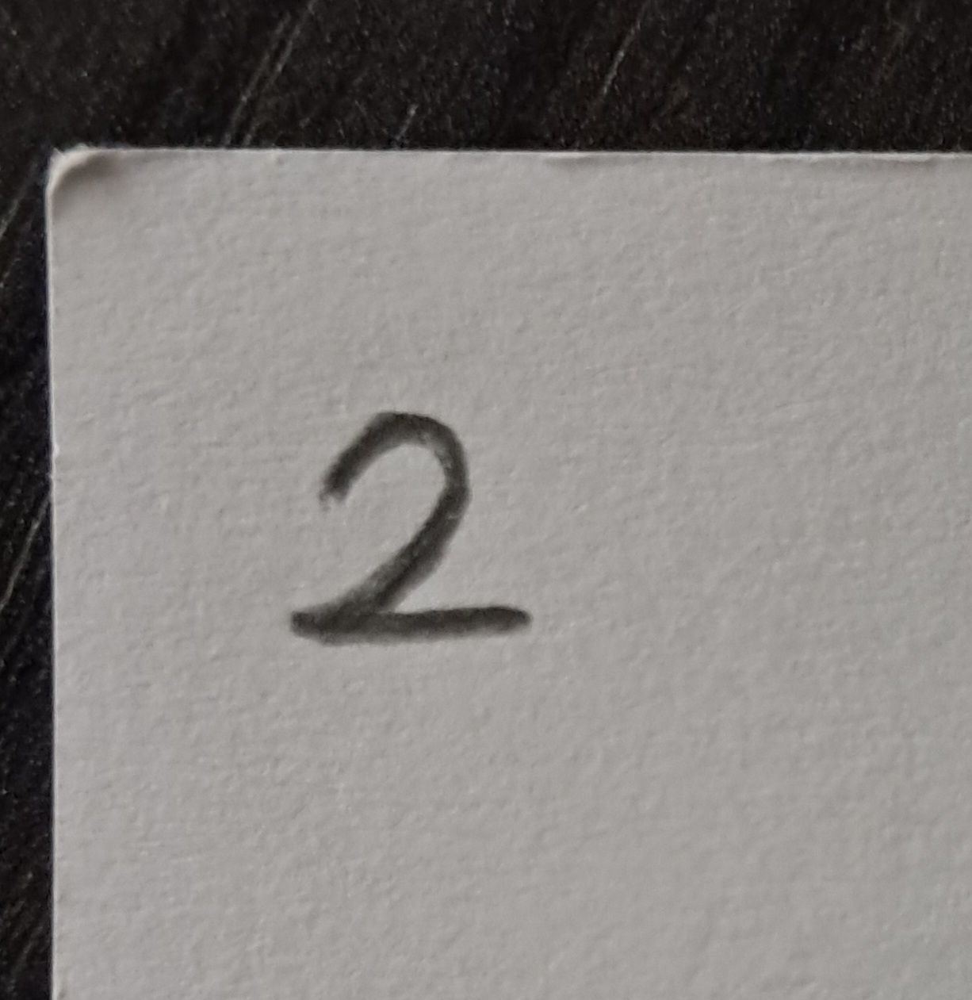
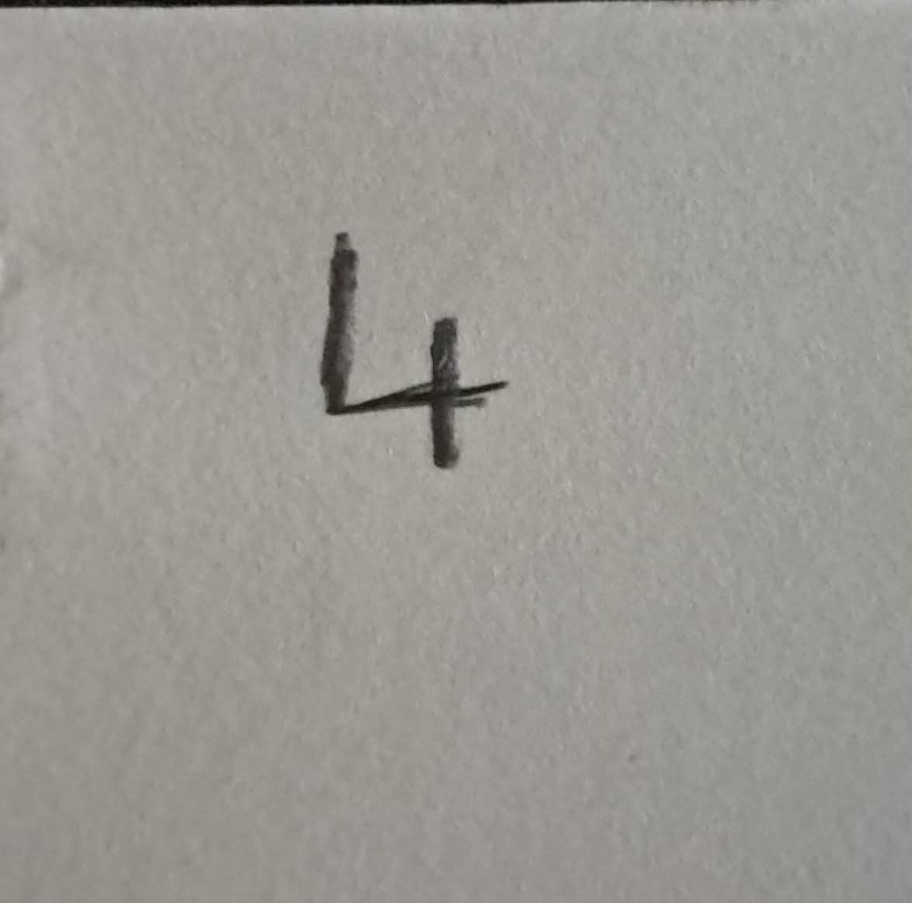
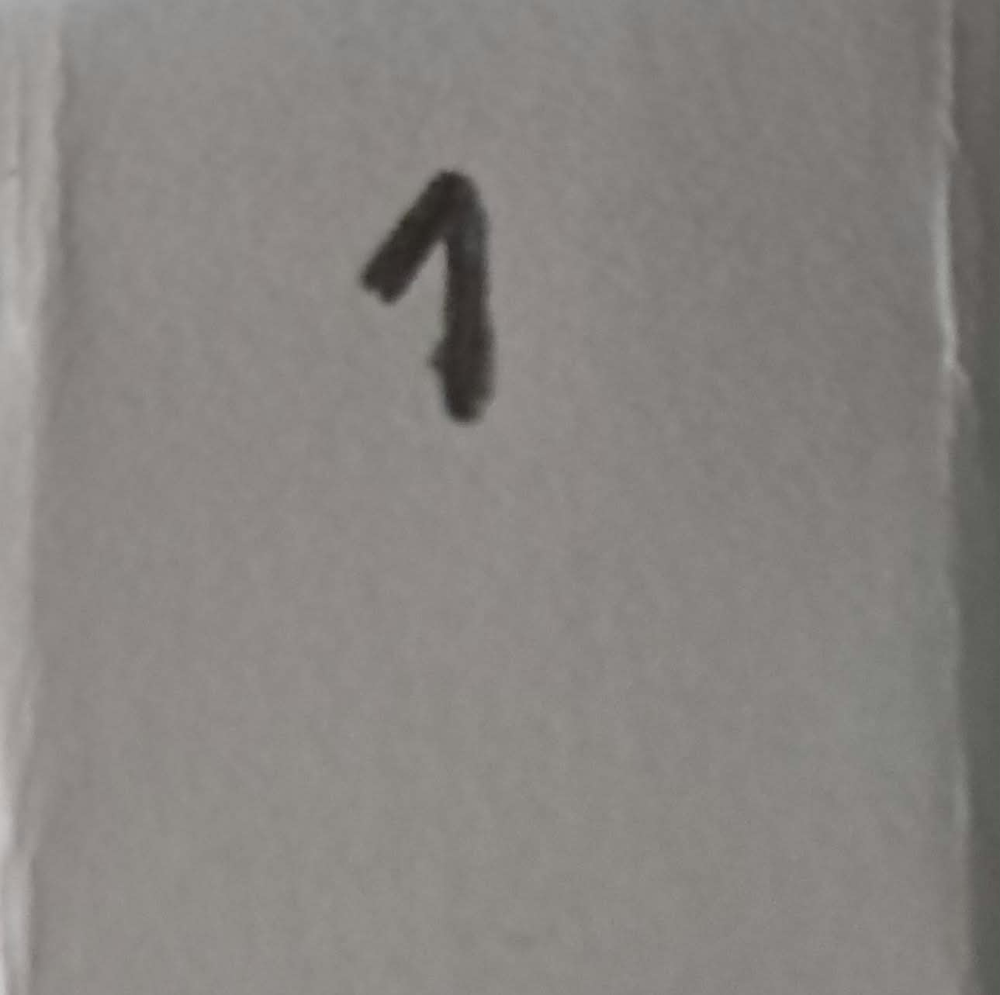
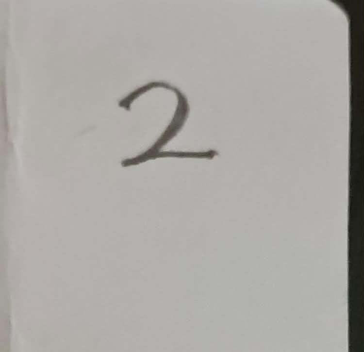
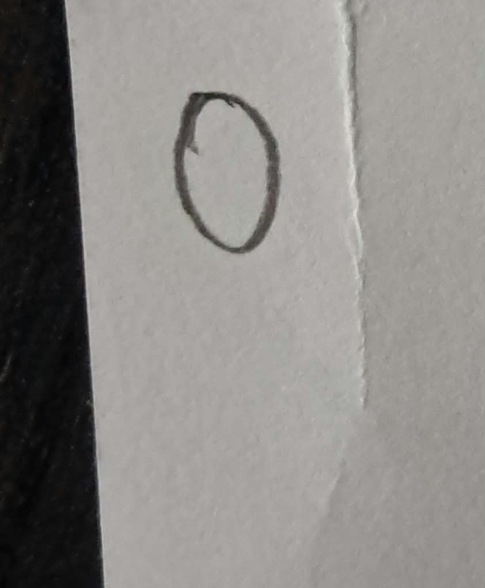
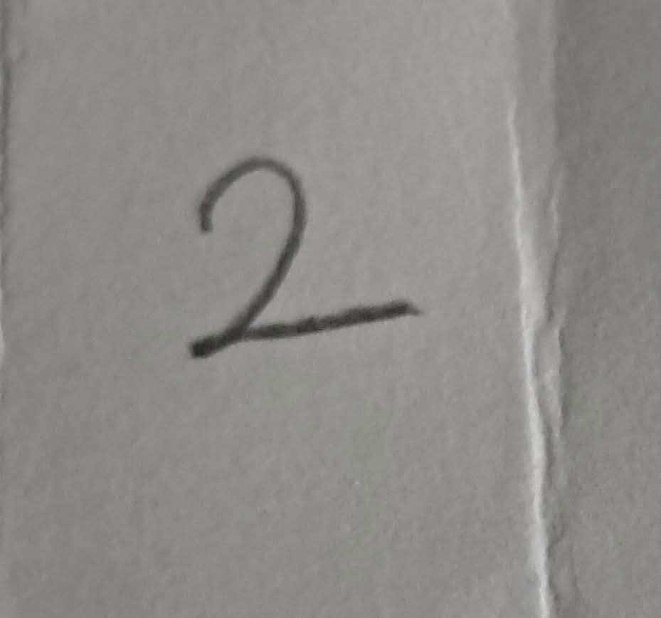
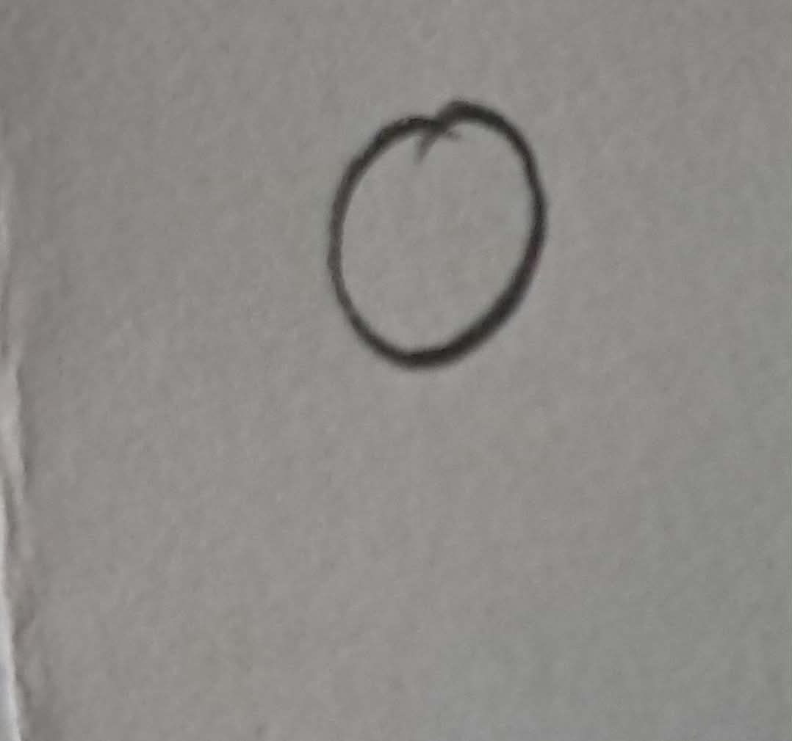
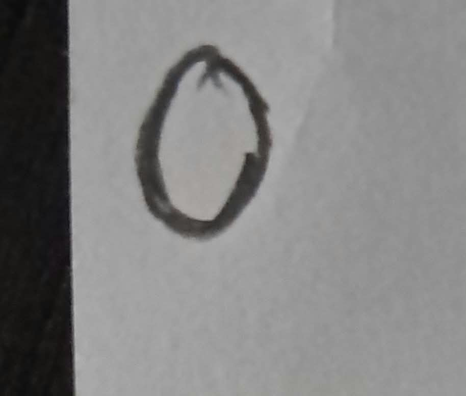
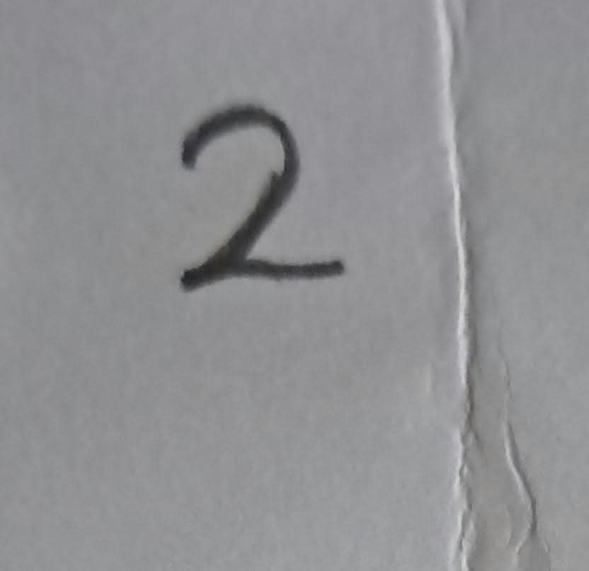

# MNIST Veri Seti ile MLP Tabanlı El Yazısı Rakam Tanıma

**Öğrenci Adı Soyadı:** Rabia Sultan Odabaş  
**Öğrenci Numarası:** 24120205026  

## 1. Proje Amacı ve Kapsamı
Bu ödevin temel amacı, Convolutional Neural Network (CNN) gibi gelişmiş mimariler kullanılmadan, yalnızca temel bir Multi-Layer Perceptron (MLP) modeli ile el yazısı rakam tanıması gerçekleştirmektir. Model sıfırdan oluşturulmuş, hazır ağırlıklar kullanılmamış ve MNIST veri seti manuel olarak Train, Validation ve Test kümelerine ayrılarak eğitilmiştir. Projenin final aşamasında, eğitilen modelin gerçek hayat verilerine genellenebilirliği (generalization), kendi el yazımla oluşturduğum öğrenci numaram üzerinden test edilmiştir.

## 2. Kullanılan Veri Seti ve Model Mimarisi
Deneylerde, 28x28 piksel boyutlarında ve gri tonlamalı 0-9 arası rakamlardan oluşan **MNIST veri seti** kullanılmıştır. Veri seti rastgelelik (seed) sabitlenerek 50.000 Train, 10.000 Validation ve 10.000 Test olarak bölünmüştür. Model geliştirme sürecinde Test verisi hiçbir şekilde kullanılmamıştır.

**Kullanılan Hiperparametreler ve Yapı:**
- **Girdi Katmanı:** 784 nöron (28x28 düzleştirilmiş)
- **Gizli Katman 1:** 128 Nöron (Aktivasyon: ReLU)
- **Gizli Katman 2:** 64 Nöron (Aktivasyon: ReLU)
- **Çıktı Katmanı:** 10 Nöron (Sınıflandırma)
- **Loss Fonksiyonu:** CrossEntropyLoss
- **Optimizer:** Adam (Learning Rate: 0.001)
- **Epoch Sayısı:** 10
- **Batch Size:** 64

## 3. Deney Sonuçları (Performans Analizi)
Model 10 epoch boyunca eğitilmiş ve test veri setinde tatmin edici bir başarıya ulaşmıştır:
- **Training Accuracy (Eğitim Doğruluğu):** ~ %98
- **Validation Accuracy (Doğrulama Doğruluğu):** ~ %96
- **Test Seti Doğruluğu (Test Accuracy):** %96.90
- *(Eğitim sürecine ait epoch bazlı Loss ve Accuracy grafikleri projedeki `odev.ipynb` dosyasının içinde çizdirilmiştir).*

---

## 4. Kendi El Yazım ile Hazırlanan Veriler (Gerçek Dünya Testi)
Ödev gereksinimi olarak beyaz kağıda siyah kalemle yazdığım `24120205026` numaralı okul numaramın piksellenmiş ve modele sunulmuş görselleri aşağıdadır:

  
  
  
  
  
  
  
  
  
  
  

## 5. Deney Sonucu ve Genel Değerlendirme (Distribution Shift)
Model, laboratuvar ortamında hazırlanmış MNIST test setinde %96.90 başarı göstermiş olsa da, yukarıdaki kendi el yazısı fotoğraflarım doğrudan modele beslendiğinde başlangıçta tamamen başarısız olmuştur. Bu durum, eğitim verisi ile gerçek dünya verisi arasındaki **Distribution Shift (Veri Dağılımı Kayması)** problemini açıkça ortaya koymuştur. 

Telefon kamerasıyla çekilen fotoğraflardaki ışık gölgeleri, kağıdın beyazlığı ve tükenmez kalem inceliği, MNIST formatının (zifiri siyah arka plan, kalın fırçamsı beyaz rakamlar) karakteristiğinden çok farklıdır. Bu uyumsuzluğu aşmak (Generalization sağlamak) için fotoğraflara **Veri Ön İşleme (Pre-processing)** uygulanmıştır:
1. **Otsu Thresholding:** Gölgeler temizlenerek arka plan tam siyah, rakam tam beyaz yapılmıştır.
2. **Contour Detection:** Rakamın koordinatları bulunarak etrafındaki gereksiz boşluklar kesilmiştir.
3. **Dilation & Normalizasyon:** Çizgi kalınlığı MNIST standartlarına çekilmiş ve matris değerleri -1 ile 1 arasına ölçeklenmiştir.

**MLP Mimarisinin Yetersizliği:**
Ön işleme adımlarından sonra doğruluk oranı artsa da hala yanlış tahminler gözlemlenmiştir. Bunun temel sebebi **MLP'nin uzamsal değişmezlik (spatial invariance) yeteneğinin olmamasıdır**. Görüntüleri 2D matris olarak değil, 1D vektör (Flatten: 784 eleman) olarak işleyen MLP, rakamın şekline değil piksellerin ezberlenmiş koordinatlarına odaklanmaktadır. Yazıdaki ufak bir eğim veya konum kayması, Flatten sonrasında tamamen yabancı bir girdi oluşturur. 

**Sonuç:** Bu deney, görüntü işleme problemlerinde mekansal özellikleri koruyan evrişimli (CNN) mimarilere neden ihtiyaç duyulduğunu ve salt MLP'nin gerçek dünya verilerinde (kendi el yazımda) genelleme yapma konusunda ne kadar zayıf kalabildiğini uygulamalı olarak göstermiştir.